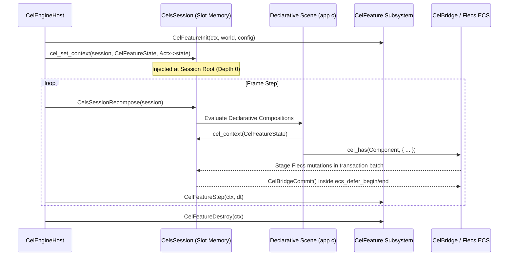

# Feature Technical Specification: [Feature Name]

> **Instructions**: This document consolidates the 3 core technical design pillars agreed upon during task planning. It serves as the single source of truth comment on the Parent Feature issue. Follow CELS (Composition, Evaluation, Lifecycle, State) and C99 standards strictly.

## Document Governance

| Field | Details |
|---|---|
| **Feature Issue** | #[Feature Issue Number] |
| **Status** | [Draft \| In Review \| Approved] |
| **Lead Engineer** | [Name / Role] |
| **Last Updated** | [YYYY-MM-DD] |

---

# 📄 Document 1: Public Interface & Usage Specification

> **Goal**: Define the public C99 contract, declarative composables, reactive state structures, and show how consumers will interact with this feature.

## 1.1 Public API & Declarative Signatures
Define the exact public interfaces, structs, function signatures, and parameter annotations in strict ISO C99.
- **Naming Rule**: Functions read **noun-first, verb-last** in PascalCase (`Cel[Noun][Verb]`, e.g., `CelWorldInit`, `CelHostStep`, `CelHostDestroy`).
- **Return Type Rule**: Fallible operations return `CelsResult` (`CELS_OK`, `CELS_ERROR_*`). Loop/step predicates return `bool`. Teardown functions return `void` (and must be null-safe).
- **Zero-Preprocessor Rule**: No inline `#ifdef` clutter inside function bodies.

```c
/**
 * @file [feature_header.h]
 * @brief Public interface contract for [Feature Name].
 */
#pragma once

#include <stdint.h>
#include <stdbool.h>
#include <cels/cels.h>
#include "cel/ecs/world.h"
#include "cel/composables/entity.h"

#ifdef __cplusplus
extern "C" {
#endif

/* ========================================================================= */
/* Configuration & State Data Structures                                     */
/* ========================================================================= */

/**
 * @brief Configuration parameters for initializing [Feature Name].
 *
 * Struct fields ordered strictly by descending memory alignment (zero compiler padding).
 */
typedef struct CelFeatureConfig {
    const char *name;              /**< Target name or identifier (8 bytes, offset 0) */
    float       tickRate;          /**< Fixed update tick rate in Hz (4 bytes, offset 8) */
    uint32_t    maxItems;          /**< Maximum item capacity (4 bytes, offset 12) */
    bool        enableTelemetry;   /**< Telemetry reporting toggle (1 byte, offset 16) */
    uint8_t     reserved[7];       /**< Explicit cache-line alignment padding (7 bytes, offset 17) */
} CelFeatureConfig;

/**
 * @brief Reactive state for [Feature Name] preserved in CELS slot memory across hot-reloads.
 */
typedef struct CelFeatureState {
    uint64_t    processedTicks;    /**< Monotonic execution counter (8 bytes, offset 0) */
    float       accumulatedTime;   /**< Total elapsed active simulation seconds (4 bytes, offset 8) */
    bool        isActive;          /**< Dynamic runtime active toggle (1 byte, offset 12) */
    uint8_t     reserved[3];       /**< Explicit alignment padding (3 bytes, offset 13) */
} CelFeatureState;

/**
 * @brief Context handle owning subsystem resources.
 */
typedef struct CelFeatureContext {
    CelFeatureConfig config;       /**< Seed configuration */
    CelFeatureState  state;        /**< Active reactive runtime state */
    CelWorld        *world;        /**< Injected CelWorld reference */
    bool             isInitialized;/**< Initialization sentinel */
    uint8_t          reserved[7];  /**< Explicit alignment padding */
} CelFeatureContext;

/* ========================================================================= */
/* Public API Functions (Noun-First, Verb-Last)                              */
/* ========================================================================= */

/**
 * @brief Generates default configuration for [Feature Name].
 * @return CelFeatureConfig populated with canonical defaults.
 */
CelFeatureConfig CelFeatureDefaultConfig(void);

/**
 * @brief Initializes [Feature Name] subsystem and registers ambient context.
 *
 * @param[in,out] ctx    Pointer to uninitialized CelFeatureContext. Non-NULL.
 * @param[in]     world  Pointer to active CelWorld instance. Non-NULL.
 * @param[in]     config Pointer to feature config. If NULL, default config is used.
 * @return CELS_OK on success; CelsResult error code on failure.
 */
CelsResult CelFeatureInit(CelFeatureContext *ctx, CelWorld *world, const CelFeatureConfig *config);

/**
 * @brief Executes a single update step for [Feature Name].
 *
 * @param[in,out] ctx       Pointer to active CelFeatureContext. Non-NULL.
 * @param[in]     deltaTime Elapsed step delta in seconds.
 * @return true if execution should continue; false if completion/termination requested.
 */
bool CelFeatureStep(CelFeatureContext *ctx, float deltaTime);

/**
 * @brief Gracefully tears down [Feature Name] resources with zero leaks.
 *
 * Must be safe to invoke on NULL or partially initialized context.
 *
 * @param[in,out] ctx Pointer to CelFeatureContext. Safe if NULL.
 */
void CelFeatureDestroy(CelFeatureContext *ctx);

/* ========================================================================= */
/* Declarative Composable Prototypes & Ambient Context Macros                 */
/* ========================================================================= */

/**
 * @brief Resolves active CelFeatureState from ambient session context.
 */
#define cel_feature_state() \
    ((CelFeatureState *)CelsScopeFind(CelsGetCurrentSession() ? CelsGetCurrentSession()->ambientScope : NULL, CelsHashKey("CelFeatureState")))

/**
 * @brief Declarative entity composable prototype for this feature.
 */
CEL_EntityDecl(CelFeatureEntity, const char *name);

/**
 * @brief Declarative root composition tree prototype.
 */
CEL_Composition(CelFeatureRoot, void*, userData);

#ifdef __cplusplus
}
#endif
```

## 1.2 Data Structures & Memory Alignment
- **Field Layout Rule**: Order struct members from largest alignment to smallest (`uint64_t`/pointers $\rightarrow$ `uint32_t`/`float` $\rightarrow$ `uint16_t` $\rightarrow$ `uint8_t`/`bool` + explicit `reserved[]` padding).
- **Cache-Line Alignment**: Top-level contexts and slot memory slabs must align to 64 bytes (`CELS_ALIGN_64` / `CEL_SLAB`).
- **Zero-Heap Rule**: Zero heap allocations (`malloc`/`free`) during active recomposition passes. All transient state must be allocated from session slot memory (`cel_remember_state`).

## 1.3 Usage Guide & Complete Code Example
Show complete, compilable C99 usage demonstrating host setup, ambient context injection at depth 0, declarative scene composition, and clean teardown:

```c
#include "[feature_header.h]"
#include <stdio.h>

int main(void) {
    /* 1. Initialize ECS World */
    CelWorld world;
    if (CelWorldInit(&world, NULL) != CELS_OK) {
        fprintf(stderr, "Failed to initialize CelWorld\n");
        return 1;
    }

    /* 2. Initialize Feature Subsystem with canonical defaults */
    CelFeatureContext featureCtx;
    CelFeatureConfig config = CelFeatureDefaultConfig();
    config.tickRate = 60.0f;

    CelsResult result = CelFeatureInit(&featureCtx, &world, &config);
    if (result != CELS_OK) {
        fprintf(stderr, "Failed to init feature: %d\n", (int)result);
        CelWorldDestroy(&world);
        return 1;
    }

    /* 3. Execute fixed simulation steps */
    const float dt = 1.0f / 60.0f;
    for (int i = 0; i < 100; ++i) {
        if (!CelFeatureStep(&featureCtx, dt)) {
            break;
        }
    }

    /* 4. Graceful teardown (null-safe, reverse-dependency order) */
    CelFeatureDestroy(&featureCtx);
    CelWorldDestroy(&world);

    return 0;
}
```

## 1.4 Error Handling & Contracts
- **Return Type Strategy**: Strictly `CelsResult` for operational failures (`CELS_ERROR_INVALID_ARGUMENT`, `CELS_ERROR_OUT_OF_MEMORY`).
- **Assertions**: `assert()` reserved exclusively for internal programmer contract violations (e.g., calling composables outside an active `CelsSession`).
- **Control Flow**: Single-exit `goto cleanup;` pattern once resources or groups are established.
- **Null Safety**: All destructors (`CelFeatureDestroy`) and getters must safely accept `NULL` pointers without faulting.

---

# 📄 Document 2: Feature Architecture & Task Decomposition

> **Goal**: Detail the internal CELS architecture, decompose the feature into sequenced tasks, and show how they interact.

## 2.1 Subsystem Architecture & Interaction Flow


## 2.2 Architectural Decisions (ADRs)
- **ADR-01: CELS Ambient Context for Subsystem State**
  - **Context**: Scene composables inside dynamic DLLs need access to feature state without parameter drilling.
  - **Decision**: Inject `CelFeatureState` into session ambient scope (`cel_set_context`) during host startup; scenes access via `cel_context(CelFeatureState)`.
  - **Trade-offs**: Decouples scene signatures from engine plumbing; requires host to initialize context before first recomposition pass.
- **ADR-02: Zero Preprocessor Clutter & Platform Decomposition**
  - **Context**: Scattered `#ifdef` blocks inside functions degrade readability and testability.
  - **Decision**: Zero inline preprocessor blocks in function bodies. Platform logic isolated into static helper functions (`CelPlatform...`); configuration defaults resolved via designated initializers.
  - **Trade-offs**: Clean, linear control flow; requires dedicated helper trampolines.

## 2.3 Granular Task Decomposition
Decompose into atomic, testable tasks following CELS TDD sequencing:

1. **Task 1: Public Interface, Struct Layouts & Test Scaffolding**
   - **Scope**: Create public header (`include/cel/...`), typedef structs with descending alignment, declare PascalCase noun-first functions with `CelsResult`, and construct CTest unit test scaffolding.
   - **Deliverable**: Compilable header, mock test suite verifying zero padding holes via `sizeof` and `offsetof` assertions.
2. **Task 2: Core Subsystem Engine & Reactive State Implementation**
   - **Scope**: Implement core internal algorithms, state transitions, static helper decomposition (< 30 lines per helper), and single-exit cleanup logic in `src/...`.
   - **Deliverable**: Functional subsystem logic passing unit and boundary test suites.
3. **Task 3: Declarative Composable Integration, Ambient Context & Live Hot-Reload Verification**
   - **Scope**: Implement declarative composable DSL bindings (`CEL_Entity`, `CEL_Composition`), register ambient context, wire into scene `app.c`, and verify hot-reload state retention across dynamic reloads.
   - **Deliverable**: End-to-end integration verified with 100% CTest pass rate and zero memory leaks.

## 2.4 Task Interaction & Dependency Matrix
| Task | Depends On | Interacts With | Role in Overall Feature |
|---|---|---|---|
| **Task 1** | None | CelWorld, CelsSession | Establishes public API contract & test scaffolding |
| **Task 2** | Task 1 | Task 1 Data Structures | Implements core subsystem logic and reactive state |
| **Task 3** | Task 2 | Cels Dynamic Loader, Scene Composable | Exposes declarative DSL & live validation in scene app |

---

# 📄 Document 3: Agreed Test Plan & Verification Strategy

> **Goal**: Define test cases and verification methodology to prove correctness and C99/CELS standards adherence.

## 3.1 Key Test Scenarios
- **Critical Paths (Happy Path)**:
  - `test_feature_init_default`: Verifies successful initialization with canonical default configuration.
  - `test_feature_step_execution`: Verifies simulation stepping, state counter increments, and valid delta-time handling.
  - `test_feature_composable_mounting`: Verifies declarative entity composable correctly stages components into Flecs.
- **Edge Cases & Failure Modes**:
  - `test_feature_init_null_args`: Verifies `CelFeatureInit(NULL, ...)` returns `CELS_ERROR_INVALID_ARGUMENT`.
  - `test_feature_destroy_null_safe`: Verifies `CelFeatureDestroy(NULL)` is a safe no-op.
  - `test_feature_zero_padding_layout`: Asserts exact `sizeof` and `offsetof` for all structs to guarantee zero compiler-inserted padding holes.
  - `test_feature_ambient_context_resolution`: Verifies `cel_context(CelFeatureState)` resolves correctly inside a composable pass.
  - `test_feature_state_retention_across_reload`: Verifies that slot-remembered state preserves monotonic counters across simulated dynamic module reload.

## 3.2 Testing Approach & Mocking Strategy
- **Unit Testing**: Isolated tests using CTest harness. Direct validation of structs, functions, and state machines.
- **Mocking Strategy**: Use lightweight stub `CelWorld` and dummy `CelsSession` without launching external graphical windows or networking.
- **Integration Testing**: Executed via test scene fixture (`test_ecs_scene`) with live Flecs REST telemetry validation.

## 3.3 Acceptance Benchmarks (FRD Validation)
- [ ] 100% CTest suite pass rate across GCC, Clang, and MSVC.
- [ ] Zero memory leaks validated via AddressSanitizer (`-fsanitize=address`) / Valgrind.
- [ ] Zero compiler warnings with `/W4 /WX` (MSVC) and `-Wall -Wextra -Wpedantic -Werror` (GCC/Clang).
- [ ] Zero inline `#ifdef` statements in implementation functions.
- [ ] No duplicate revision files (`app_v2.c`); all scene changes made in-place.
